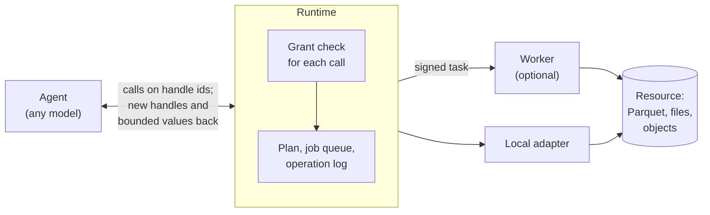
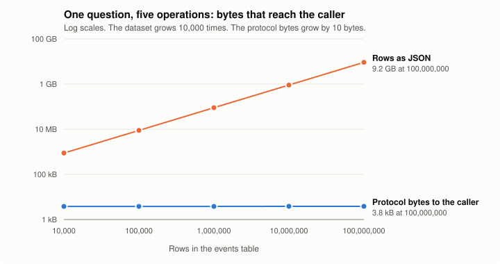

# DataHandles

[](https://github.com/psantillan/datahandles/actions/workflows/tests.yml)
[](https://github.com/psantillan/datahandles/releases)

[](LICENSE)

A protocol and a reference runtime that let an AI agent work on a resource through a reference
instead of a copy.

An agent gets a **handle**: an opaque id, a type, a schema, and a list of typed capabilities. It
invokes capabilities on the handle. A capability returns a new handle (no data moves) or a
bounded value (a small, size-limited answer). The runtime checks each call against the grants of
the caller and runs it where the resource is: in process or on a remote worker. A long operation
runs as a job, and the job is a handle too.

A resource is anything that an adapter can wrap. This release has adapters for JSON objects, a
read-only file tree, tabular files through DuckDB, git repositories, and browser sessions. An
installed package can add more. The core does not know any of these types.

The property that this project tests:

> Context consumption should scale with the complexity of the question, not the size of the
> underlying dataset.



The agent sees only the left side of this picture. Rows, files, and credentials stay on the right.

## Measured

One question (filter, join, aggregate, sort, bounded read) on a Parquet file that grows from
10,000 rows to 100,000,000 rows. Full method and all rows: [`benchmarks/RESULTS.md`](benchmarks/RESULTS.md).



| Event rows | Rows as JSON | Protocol bytes to caller | Answer bytes | Time |
|---:|---:|---:|---:|---:|
| 10,000 | 877,653 B | 3,730 B | 147 B | 0.073 s |
| 1,000,000 | 89,794,093 B | 3,732 B | 146 B | 0.106 s |
| 100,000,000 | 9,179,443,674 B | 3,739 B | 146 B | 1.681 s |

The dataset grows 10,000 times. The bytes that go to the caller grow by 9.

"Protocol bytes" is the JSON size of everything that the runtime returns for the question: five
operation results and four handle summaries. One machine, one run for each size, DuckDB 2.0.0.

### With a language model

A 9B-parameter local model (`ornith-1.5:9b` on Ollama, one GTX 1080, context window 8,192 tokens)
gets two tools and two handle ids. It never gets a file. Full method, all runs, and every
message: [`benchmarks/AGENT_RESULTS.md`](benchmarks/AGENT_RESULTS.md).

Peak prompt tokens in one conversation:

| Question | Operations needed | 10,000 rows | 1,000,000 rows | 100,000,000 rows |
|---|---:|---:|---:|---:|
| Count the rows | 1 | 1,988 | 1,998 | 2,030 |
| Count the rows that pass a filter | 2 | 2,202 | 2,212 | 2,240 |
| Group, sum, and find the largest group | 4 | 3,827 | 3,924 | 2,862 |
| Join two datasets, filter, group, sum, top 3 | 5 | 4,802 | 5,015 | 4,569 |

The model gave the correct answer in 12 of 12 runs. The check is one direct SQL statement.
The prompt grows with the question. It does not grow with the dataset. The rows of the smallest
dataset as JSON would cost about 353,667 tokens (35.4 tokens for each row, measured), which is 43
times the context window.

The calls of the join question on 100,000,000 rows, from the recorded transcript (ids shortened):

```text
Q: Which 3 countries have the most revenue from 'purchase' events? ...

handle_describe(events)                                   -> schema and 9 capabilities
handle_describe(customers)                                -> schema and 9 capabilities
handle_invoke(events,    dataset.filter, event_type = purchase)  -> handle …TGEJ
handle_invoke(customers, dataset.head,   n = 10)                 -> 10 rows
handle_invoke(…TGEJ,     dataset.join,   right = customers, on customer_id) -> handle …0N3
handle_invoke(…0N3,      dataset.aggregate, sum(amount) by country)          -> handle …MY10
handle_invoke(…MY10,     dataset.sort,   revenue descending)     -> handle …TAG2
handle_invoke(…TAG2,     dataset.limit,  n = 3)                  -> handle …N3Y
handle_invoke(…N3Y,      dataset.head)   -> [["BR", 480478088.8], ["MX", 477718993.2], ["US", 477524682.5]]

A: The 3 country codes are BR, MX, US.
```

Two runs had failed tool calls, and the model recovered in both from the typed errors:

- One run (join, 1,000,000 rows) dropped one character from a 26-character handle id three times
  (`HANDLE_NOT_FOUND`), then sent the correct id.
- One run (group, 100,000,000 rows) made no `handle_describe` call. It guessed the capability
  names and inputs, got 9 errors (`CAPABILITY_NOT_FOUND`, `INVALID_INPUT`), and corrected each
  call from the error details. That is why its prompt is smaller than the other two in its row.

One run for each cell, temperature 0. A `handle_describe` result costs about 1,230 tokens, which is
the largest single part of each prompt.

### Two kinds of resource, through MCP

The same 9B model got one task through the MCP server, with no handle id: a git repository says
where its status page is, and the answer is on the release notes of that site. The README of the
repository names an older version, so the repository alone gives a wrong answer. In 5 of 5 runs
the model found both handles, read the repository, used the browser, and named the correct
version. No tool call failed, and the peak prompt was 4,536 tokens. Method and every message:
[`benchmarks/AGENT_MCP_RESULTS.md`](benchmarks/AGENT_MCP_RESULTS.md).

## Example

```python
from datahandles import connect

client = connect(".datahandles", principal="analyst")
events = client.register("events", adapter="duckdb", source="events.parquet")
customers = client.register("customers", adapter="duckdb", source="customers.csv")

# Each step returns a new handle. No step runs a query.
purchases = events.invoke("dataset.filter", {"where": [{"column": "event_type", "op": "eq", "value": "purchase"}]})
joined = purchases.invoke("dataset.join", {"right": customers, "on": [{"left": "customer_id", "right": "customer_id"}]})
revenue = joined.invoke("dataset.aggregate", {"group_by": ["country"], "metrics": [{"fn": "sum", "column": "amount", "as": "revenue"}]})
ranked = revenue.invoke("dataset.sort", {"by": [{"column": "revenue", "descending": True}]})

# A capability that returns a value runs the plan in DuckDB. Only the bounded answer comes back.
ranked.invoke("dataset.head", {"n": 3})
# {'columns': ['country', 'revenue'], 'rows': [['US', 12095631.0], ['CA', 11951866.5], ['MX', 11951820.0]], 'truncated': False}

# A second principal gets only what the owner grants.
ranked.grant("agent", ["dataset.count"])
```

The full program is [`examples/quickstart.py`](examples/quickstart.py). It makes its own data.

## How it works

- **Handle.** A reference with a kind: `resource` (an external thing), `computation` (a plan
  that did not run), `result` (a stored output), or `job` (an operation that runs in the
  background). A handle holds no data and no credential.
- **Capability.** A typed operation with JSON Schemas for its input and output. It declares if
  it returns a value or a handle, its effects, and its output size limit.
- **Lazy by default.** An operation that returns a handle only records a plan step. The DuckDB
  adapter compiles the full plan to one SQL statement when a value is requested. `eager=True`
  runs the plan and stores the output as a `result` handle pinned to the source version.
- **Bounded output.** Each value capability has a byte limit. The runtime refuses a larger
  output with a typed error. Adapters truncate and say so.
- **Authorization is separate from the handle.** A handle id gives no authority. The runtime
  checks each operation against the grants of the principal. A derived handle gives no more
  than the handles it derives from.
- **Adapters.** A resource type is one class with six methods: `open`, `describe`, `discover`,
  `invoke`, `observe`, `release`. The core does not know any resource type. Five adapters
  exist: `memory` (JSON objects), `filesystem` (read-only directory tree), `duckdb` (Parquet,
  CSV, and DuckDB files), `git` (a repository, read-only), and `browser` (a headless Chromium
  session). A separate package can add an adapter through the entry point group
  `datahandles.adapters`.
- **Registry.** Handles, grants, lineage, jobs, and an operation log live in SQLite and survive
  a restart.
- **No language model is needed.** The runtime is a plain library.

- **Jobs.** An operation with `background=True` returns a job handle at once. The job is a
  resource: `job.status`, `job.cancel`, and `job.result` are its capabilities. Several jobs run
  at the same time, and a long call on one resource does not hold up another resource. A job
  survives a restart of the runtime.
- **Cancel and time limits.** `job.cancel` stops the adapter call of a running job: the git
  adapter kills its process, the browser adapter cancels the page load. A capability can declare
  `limits.timeout_ms`; a call past it ends with `OPERATION_TIMEOUT`.
- **Workers.** A resource can be on a remote worker, next to the data. The same program gives
  the same answers, and no handle shows where it runs.

## Remote use

Three processes. The worker is next to the data. The runtime holds the registry and the grants.
The client holds a URL and a token.

```
python -m datahandles.workers.remote --state worker-state --key-file worker.key --adapters duckdb --port 8471
python -m datahandles.protocols.http --state state --tokens tokens.json --port 8470 --worker w1,http://127.0.0.1:8471,worker.key
```

`tokens.json` maps each bearer token to a principal: `{"a-long-random-token": {"principal": "analyst", "create": true}}`.

```python
client = connect("http://127.0.0.1:8470", token="a-long-random-token")
events = client.register("events", adapter="duckdb", source="/data/events.parquet", worker="w1")

purchases = events.filter(where=[{"column": "event_type", "op": "eq", "value": "purchase"}])  # the short call form
purchases.count()                                    # the worker runs the plan, and one number comes back

job = purchases.invoke("dataset.aggregate", {"metrics": [{"fn": "sum", "column": "amount", "as": "revenue"}]},
                       eager=True, background=True)  # a job handle, at once
job.wait().head()                                    # a handle to the stored output, then a bounded read
```

[`examples/remote.py`](examples/remote.py) runs all three parts in one program.

Both servers use plain HTTP. Put them behind TLS or on a private network.

## For a language model (MCP)

The MCP server gives a model three tools: `handle_find`, `handle_describe`, `handle_invoke`.

```
python -m datahandles.protocols.mcp --state state --principal agent --register events=duckdb:/data/events.parquet
DATAHANDLES_TOKEN=a-long-random-token python -m datahandles.protocols.mcp --url http://127.0.0.1:8470
```

The first form opens a local state directory. The second form connects to a runtime over HTTP.
The server uses stdio and needs the `mcp` package (`pip install -e ".[mcp]"`).

## State

Version 0.2. Built: the protocol schemas, the runtime, five adapters, composition and graphs,
the registry, async jobs on several threads with cancel and time limits, the remote worker, the
HTTP transport, the MCP adapter, a Python client, installed adapters, and a conformance suite.
[`ROADMAP.md`](ROADMAP.md) has the table with the evidence for each part, the plan for later
versions, and the limits of the current code.

## Documents

| File | Content |
|---|---|
| [`SPECIFICATION.md`](SPECIFICATION.md) | The protocol, in normative terms |
| [`spec/protocol/`](spec/protocol/) | JSON Schemas for handles, capabilities, operations, results, graphs, errors |
| [`ARCHITECTURE.md`](ARCHITECTURE.md) | The design document that the project started from |
| [`ROADMAP.md`](ROADMAP.md) | What is built, what is not, known limits |
| [`SECURITY.md`](SECURITY.md) | What the runtime protects and what it does not |

## Run it

```
python3 -m venv .venv
.venv/bin/pip install -e ".[dev]"
.venv/bin/python -m playwright install --only-shell chromium
.venv/bin/python examples/quickstart.py
.venv/bin/python examples/remote.py
.venv/bin/python -m pytest tests -q
.venv/bin/python tests/mutation_check.py
.venv/bin/python benchmarks/context_efficiency.py 10000000
OLLAMA_URL=http://localhost:11434 OLLAMA_MODEL=ornith-1.5:9b .venv/bin/python benchmarks/agent_context.py 1000000
OLLAMA_URL=http://localhost:11434 OLLAMA_MODEL=ornith-1.5:9b .venv/bin/python benchmarks/agent_mcp.py 5
```

- `tests/integration/test_acceptance.py` has one test for each row of the acceptance table in
  the design document.
- `tests/conformance/` uses protocol methods only. It runs on the reference runtime in process,
  over HTTP, and with a worker. With `DATAHANDLES_URL` and two tokens it runs against any runtime
  that offers the HTTP binding ([`SPECIFICATION.md`](SPECIFICATION.md) section 17). No second
  implementation exists yet.
- The mutation check removes 54 guards from the source, one at a time, and confirms that a test
  fails for each.
- Install from a checkout with `-e`. The schemas load from `spec/protocol/` in the repository tree.
- The benchmark argument is the largest row count. `100000000` needs about 11 GB of free disk.
- The agent benchmarks need an Ollama server and a model that supports tool calls.

## Layout

```
spec/protocol/        JSON Schemas (the protocol)
packages/core/        ids, errors, schema validation, graph ordering
packages/runtime/     runtime, registry, jobs, adapter contract
packages/adapters/    memory, filesystem, duckdb, git, browser
packages/workers/     the remote HTTP worker
packages/protocols/   HTTP transport, MCP adapter, the tool surface for a language model
packages/sdk/         Python client
tests/integration/    acceptance tests
tests/conformance/    protocol tests that run against any implementation
tests/unit/           jobs, locks and cancel, worker, transports, adapters
benchmarks/           benchmarks, results, and the chart (plot.py draws it)
```

Python imports `packages/` as `datahandles`.

## License

MIT. See [`LICENSE`](LICENSE).
